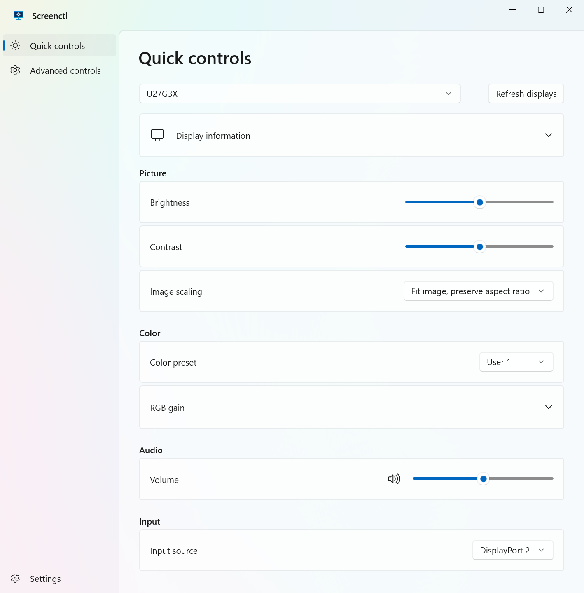
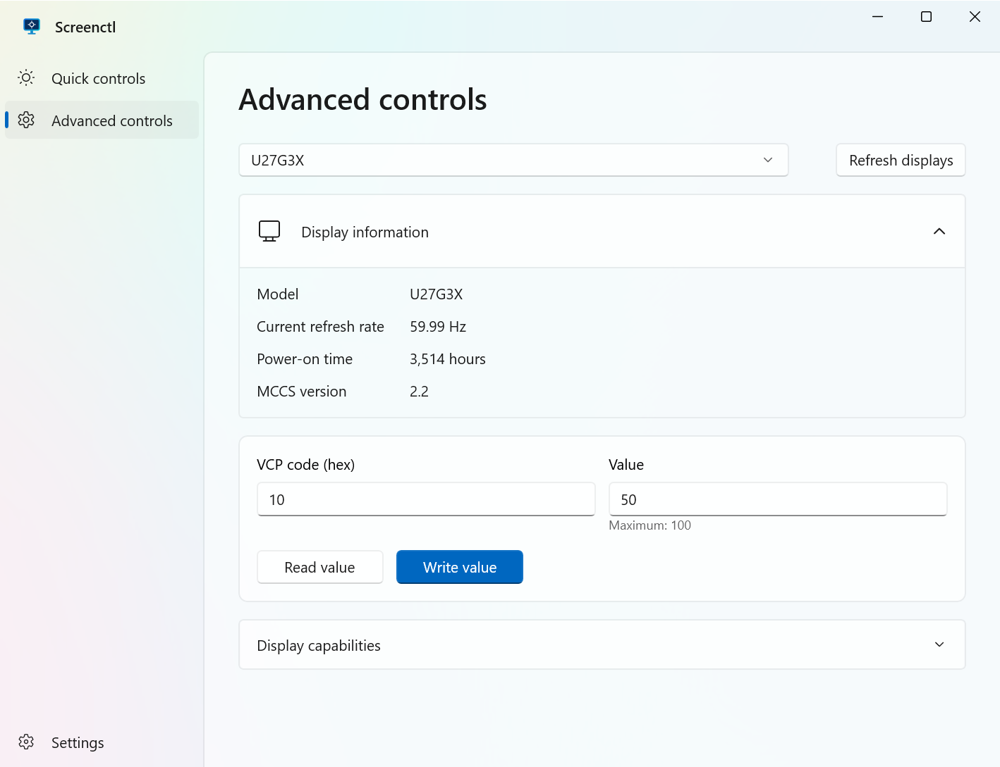

# Screenctl

A native Windows app for controlling external monitors over DDC/CI.

 

## Features

- Brightness, contrast, scaling, color presets, RGB gain, volume, mute, and input selection.
- Display information, formatted capabilities, and manual VCP commands.
- English and Simplified Chinese, with live language switching.

Available controls depend on your monitor. MCCS table operations and proprietary protocols are not supported.

## Install

Requires Windows 10 2004 or later, an x64 PC, and a DDC/CI-capable monitor. Enable DDC/CI in the monitor's menu; some docks and adapters may block it.

Download from [Releases](https://github.com/cnfatal/screenctl/releases/latest):

- **Setup EXE:** Install with administrator permission. Run a newer installer to update; uninstall through Windows Settings.
- **Portable ZIP:** Extract and run `Screenctl.exe`. Exit the app before replacing or deleting its folder.

Both include the required runtimes. Closing the window exits the app.

## Build

On Windows, install the .NET 10 SDK, PowerShell 7, GNU Make, and Inno Setup 6. Add `ISCC.exe` to `PATH`.

```powershell
make package VERSION=1.0.0
```

The installer, ZIP, and SHA256 files are written to `artifacts/`. Version tags such as `v1.0.0` trigger GitHub Releases automatically.
